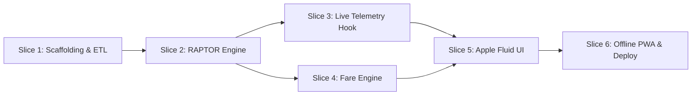

# TJ-Navigator: Implementation Roadmap & Vertical Slices

> Executable engineering plan translating all settled Wayfinder architecture decisions (ADR 0001–0005, specs, and FigCraft prototypes) into working software.

---

## Architecture Summary

- **Type**: 100% Client-Side Static PWA ($0/month hosting on Cloudflare Pages / Vercel).
- **Engine**: In-Browser RAPTOR (Round-Based Public Transit Routing) executing inside a Web Worker ($<8\text{ ms}$ search times).
- **Data Pipeline**: Build-time offline ingestion (`scripts/build-graph.ts`) packaging Transjakarta GTFS + Rail seeds into a compact $<1.5\text{ MB}$ typed array dataset (`public/data/jakarta-transit-network.json`).
- **Telemetry**: On-demand direct WebSocket MQTT connection (`wss://mqtt.tj.co.id:8084/mqtt`) feeding the **Live Segment Runtime Engine** (70% live / 30% baseline blend) for truthful arrival countdowns and traffic-aware travel times.
- **Design System**: Apple Fluid Design (WWDC fluid interfaces, translucent materials, squircle cards, spring motion, direct manipulation).

---

## Vertical Slices

---

### Slice 1: Scaffolding & Multi-Modal GTFS Pipeline
- **Deliverables**:
  - Initialize Vite + React + TypeScript + Tailwind CSS project in `tj-navigator`.
  - Install dependencies (`leaflet` / `maplibre-gl`, `lucide-react`, `motion`).
  - Create `scripts/build-graph.ts`:
    - Downloads Transjakarta GTFS (`https://gtfs.transjakarta.co.id/files/file_gtfs.zip`).
    - Merges rail seeds (`data/seeds/krl-network.json`, `mrt-network.json`, `lrt-network.json`, `transfer-hubs.json`).
    - Applies global namespacing (`tj:`, `krl:`, `mrt:`, `lrt:`).
    - Emits validated, compressed `public/data/jakarta-transit-network.json`.
- **Exit Test**: Running `npm run build:data` generates `< 1.5 MB` JSON passing bounding box and connectivity audits.

---

### Slice 2: In-Browser RAPTOR & Spatial KD-Tree
- **Deliverables**:
  - Implement `src/workers/raptor.worker.ts`:
    - Array-based RAPTOR algorithm traversing rounds (Round 0 = 0 transfers, Round 1 = 1 transfer, etc.).
    - 2D Spatial KD-tree for nearest-neighbor walking access from coordinates to halte/stations.
    - Directional transfer hub edges incorporating stairs, escalators, and rush-hour peak penalties.
  - Implement `src/lib/router/client.ts` worker RPC bridge.
- **Exit Test**: Benchmark test: Searching *Stasiun Tebet* $\rightarrow$ *Halte Tosari* returns Pareto-optimal candidates (Fastest, Direct, Cheapest) in under 10 milliseconds.

---

### Slice 3: Live MQTT Telemetry & Recounted Segment Engine
- **Deliverables**:
  - Implement `src/lib/telemetry/mqtt-client.ts`:
    - Direct browser connection to `wss://mqtt.tj.co.id:8084/mqtt`.
    - Route multiplexing (max 6 active topics per stop view).
    - Page Visibility API hook (pauses connection when screen locks / tab backgrounded).
    - 1.5-second throttled buffer flush to React state.
  - Implement `src/lib/telemetry/live-segment-engine.ts` (ADR 0005):
    - Snapping coordinates to polyline with $\pm 45^\circ$ heading alignment.
    - Rolling blend filter ($0.7 \cdot \text{observed} + 0.3 \cdot \text{baseline}$).
    - Calculates both arrival wait countdown and in-vehicle travel time.
- **Exit Test**: Live corridor stream successfully calculates arrival countdown and flags held buses at intersections.

---

### Slice 4: Multi-Modal Fare Engine
- **Deliverables**:
  - Implement `src/lib/fare/fare-engine.ts`:
    - Transjakarta flat Rp 3.500 (Rp 0 within paid gates, Rp 0 Mikrotrans).
    - KRL progressive distance formula ($3000 + \lceil (d - 25)/10 \rceil \times 1000$).
    - MRT Jakarta station-to-station matrix (Rp 3.000–14.000).
    - LRT Jakarta (Rp 5.000) and LRT Jabodebek.
    - JakLingko integrated tariff: $\min(10000, 2500 + \lceil d \rceil \times 250)$ with 45-min transfer and 180-min journey window.
- **Exit Test**: Unit tests verify exact fare calculations and JakLingko savings callouts across multi-modal journeys.

---

### Slice 5: Apple Fluid Commuter UI
- **Deliverables**:
  - Build UI components matching the FigCraft prototypes:
    - **Screen 1 (Search & Radar)**: Autocomplete origin/destination card, departures board, live radar chip.
    - **Screen 2 (Pareto Itinerary Drawer)**: Draggable bottom sheet with spring physics (`damping: 1.0`), Pareto cards (Fastest, Direct with recounted traffic delay, Lowest Fare with inside-station transfer badge).
    - **Screen 3 (Live Bus Radar)**: Full-screen interactive map, pulsing bus puck, honest arrival range (`8–11 min`), and diagnostic delay explanation card.
- **Exit Test**: Mobile browser testing on iOS Safari & Chrome Android achieves 60fps gesture dragging and responsive layout.

---

### Slice 6: Offline PWA Shell & Static Deployment
- **Deliverables**:
  - Configure Vite PWA plugin (`vite-plugin-pwa`) with Web App Manifest and Workbox caching.
  - Implement `src/lib/storage/transit-db.ts` IndexedDB storage hydration.
  - Offline vector map tile fallback renderer.
  - Setup GitHub Actions workflow for static export to Cloudflare Pages.
- **Exit Test**: Turn on Airplane Mode in mobile browser; app launches instantly, computes route searches, and displays offline maps.
