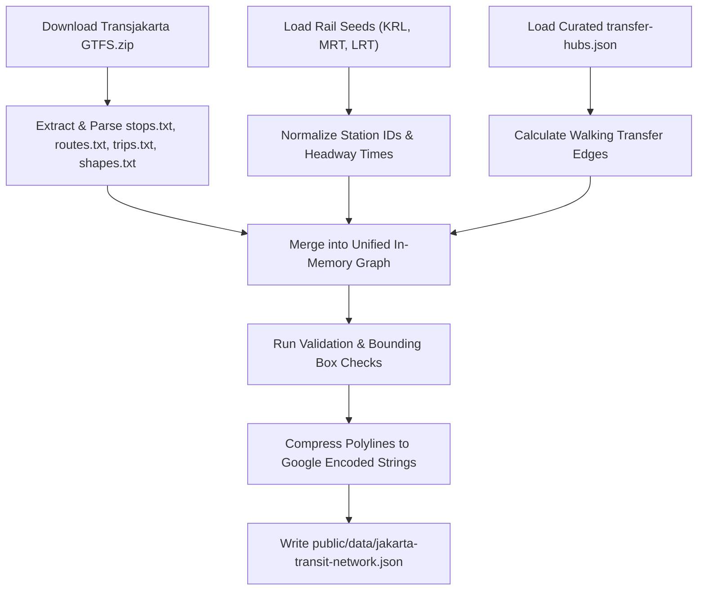

# Multi-Modal GTFS Ingestion & Compilation Pipeline Specification

> Technical specification for `scripts/build-graph.ts` compiling Transjakarta GTFS, KRL, MRT, and LRT datasets into a compact in-browser RAPTOR graph.

---

## 1. Source Data Matrix

| Transit Mode | Source Format | Source Location | Ingestion Cadence |
| :--- | :--- | :--- | :--- |
| **Transjakarta BRT & Feeders** | Official GTFS zip bundle | `https://gtfs.transjakarta.co.id/files/file_gtfs.zip` (~2.5 MB) | Automated build / Weekly GitHub Actions cron |
| **KRL Commuterline** | Seed JSON / Comuline station & route dictionary | `data/seeds/krl-network.json` (6 lines, 110 stations) | Static seed + Quarterly KAI timetable updates |
| **MRT Jakarta** | Seed JSON / Official Timetable | `data/seeds/mrt-network.json` (1 line, 13 stations) | Static seed (5m peak / 10m offpeak headway) |
| **LRT Jabodebek & Jakarta** | Seed JSON / Official Timetable | `data/seeds/lrt-network.json` (3 lines, 24 stations) | Static seed |
| **Transfer Hubs & Skywalks** | Curated Pedestrian Edges | `data/seeds/transfer-hubs.json` (Dukuh Atas, CSW, Kebayoran, etc.) | Hand-curated calibrated walking buffers |

---

## 2. Global Entity Namespacing

To avoid stop ID collisions across transit authorities, every stop/station and route is prefixed with its authority namespace:

- `tj:<id>`: Transjakarta stops & corridors (e.g. `tj:1-1` for *Halte Blok M*, `tj:corridor-1` for *Blok M <-> Kota*).
- `krl:<code>`: KRL Commuterline stations (e.g. `krl:MRI` for *Manggarai*, `krl:SUD` for *Sudirman*).
- `mrt:<code>`: MRT Jakarta stations (e.g. `mrt:DKA` for *Dukuh Atas BNI*, `mrt:BLM` for *Blok M BCA*).
- `lrt:<code>`: LRT stations (e.g. `lrt:JTM` for *Jati Mulya*, `lrt:VEL` for *Velodrome*).

---

## 3. High-Performance RAPTOR Data Layout

To allow browser Web Workers to run multi-criteria RAPTOR queries in **under 8 milliseconds**, the compiled JSON avoids heavy object nesting and stores topology in contiguous, indexed typed arrays:

```typescript
export interface CompiledTransitNetwork {
  version: string;
  generatedAt: string;
  
  // Compact Stops Directory: [id, name, lat, lon, modeEnum]
  stops: Array<[string, string, number, number, number]>;
  
  // Routes: [id, shortName, longName, colorHex, stopIndicesArray, headwaySeconds]
  routes: Array<[string, string, string, string, number[], number]>;
  
  // Inverted Index: stopIndex -> array of routeIndices passing through this stop
  stopRoutes: number[][];
  
  // Pre-calculated inter-modal walking transfers: [fromStopIndex, toStopIndex, walkSeconds]
  transfers: Array<[number, number, number]>;
  
  // Route polylines for map drawing (encoded polyline string per route)
  routeShapes: Record<string, string>;
}
```

### Enumerations:
- `modeEnum`: `0 = BRT`, `1 = NON_BRT`, `2 = COMMUTER_RAIL`, `3 = MRT`, `4 = LRT`, `5 = MIKROTRANS`.

---

## 4. Pipeline Execution Stages



1. **Extraction & Filtering**:
   - Download `file_gtfs.zip` into temporary memory buffer.
   - Filter for Phase 1: Corridors 1 through 14 (identifiable via corridor prefixes `1`, `2`, ..., `13`, `14` in `routes.txt`).
2. **Harmonization**:
   - Inject KRL Commuterline lines (Bogor, Cikarang, Rangkasbitung, Tangerang, Tanjung Priok, Airport Rail) with realistic station-to-station runtimes.
   - Inject MRT Jakarta (28-minute end-to-end trip pattern).
   - Inject LRT Jabodebek and LRT Jakarta.
3. **Transfer Hub Linkage**:
   - For every entry in `transfer-hubs.json` (e.g. *KRL Sudirman* to *MRT Dukuh Atas*), generate bidirectional transfer edges with calibrated walk durations (accounting for stairs, escalators, and turnstiles).
4. **Validation Suite**:
   - **Bounds Check**: Ensure all stops fall within Greater Jakarta latitude `[-6.75, -6.05]` and longitude `[106.60, 107.15]`.
   - **Connectivity Check**: Ensure no isolated "island" stops exist with 0 routes.
   - **Size Audit**: Ensure bundle size does not exceed the 1.5 MB threshold.
