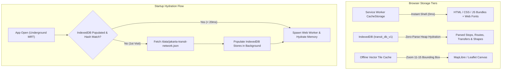

# Offline PWA, Service Worker & IndexedDB Caching Specification

> Architecture and technical specification for 100% offline transit navigation across underground MRT stations and low-signal Jakarta areas.

---

## 1. Storage Tier Architecture

---

## 2. IndexedDB Schema (`lib/storage/transit-db.ts`)

Instead of parsing a raw `1.5 MB` JSON string on every app launch (which can cause a 150ms main-thread freeze on low-end mobile devices), the parsed typed arrays are stored directly in **IndexedDB**:

- **Database Name**: `tj_navigator_store`
- **Database Version**: `1`
- **Object Stores**:
  1. `meta`: Stores version hashes, build timestamps, and user preferences (`activeTheme`, `recents`, `savedRoutes`).
  2. `stops`: Keyed by `id` (e.g. `tj:1-14`), with secondary index on `name` (for rapid prefix search / autocomplete) and `mode`.
  3. `routes`: Keyed by `id` (e.g. `tj:corridor-1`), storing stop sequence array and headway rules.
  4. `stopRoutes`: Inverted index mapping `stopId -> routeId[]`.
  5. `transfers`: Inter-modal pedestrian transfer edges with directional buffers.
  6. `shapes`: Polyline coordinates indexed by route id.

---

## 3. Service Worker Caching Policies (Workbox / Vite PWA)

| Asset Category | URL Pattern | Caching Strategy | Expiration / Revalidation |
| :--- | :--- | :--- | :--- |
| **App Shell** | `index.html`, `/assets/*.js`, `/assets/*.css` | **Cache First** | Updated via Service Worker byte-hash change |
| **Transit Network Data** | `/data/jakarta-transit-network.json` | **Stale While Revalidate** | Background revalidation with version tag comparison |
| **Static Icons & Fonts** | `/fonts/*`, `/icons/*`, `favicon.svg` | **Cache First** | 1 year cache duration |
| **Map Base Tiles** | `https://*.basemaps.cartocdn.com/*` | **Cache First (Bounded)** | Max 500 tiles, 30 days retention |
| **Live MQTT Stream** | `wss://mqtt.tj.co.id:8084/mqtt` | **Network Only (WebSocket)** | Not cached; auto-reconnects when online |

---

## 4. Offline Map Fallback Strategy

When a commuter enters an underground MRT tunnel or low-signal basement station:
1. **Cached Base Tiles**: Tiles covering Jakarta center (`zoom 11–15`) are pre-cached on first map viewing.
2. **Offline Vector Fallback**: If an uncached tile coordinate is requested while offline:
   - The map canvas displays a clean dark background (`#0A0E17`).
   - The transit network's route polyline shapes (`shapes`) and station coordinates are rendered as **pure client vector overlays**, so the commuter still sees the complete route line and station markers even without satellite or street tiles!
