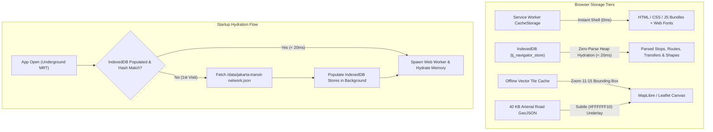

# Offline PWA, Service Worker & IndexedDB Caching Specification

> Architecture and technical specification for 100% offline transit navigation across underground MRT stations and low-signal Jakarta areas.

---

## 1. Storage Tier Architecture

---

## 2. Four Underground Resilience Refinements

### 2.1 "Lie-Fi" Timeout Detection Over `navigator.onLine`
In Jakarta MRT stations (e.g. Dukuh Atas, Istora Mandiri, Senayan), mobile devices descending escalators cling to 1 bar of dead 4G signal. `navigator.onLine` still reports `true`, causing browser fetch requests to hang indefinitely.
- **2.5s Tile Timeout**: Any raster map tile fetch that fails to resolve within **2.5 seconds** automatically aborts.
- **Telemetry Heartbeat Watchdog**: If no MQTT heartbeat ping arrives within **15 seconds**, the telemetry state immediately flips to `OFFLINE_HEADWAY_MODE` without waiting for OS disconnect events.
- **Instant Fallback**: The UI transitions seamlessly to the offline vector map and scheduled headway estimates without user-facing spinners.

### 2.2 Background Graph Versioning in IndexedDB
- `tj_navigator_store` records a `graphVersion` hash (e.g. SHA-256 of the GTFS release) in its `meta` store.
- When online, a background Web Worker checks a lightweight `GET /data/version.json` endpoint.
- If a new version exists, the worker streams and populates the new graph version in the background without interrupting the commuter's active search session, swapping the active database pointer only on next app restart.

### 2.3 Persist Active Journey & Recent Traffic Multipliers
- When a user selects an itinerary or starts active navigation, the active trip state (origin, destination, leg checklist, current progress index) and the latest corridor **Traffic Multipliers** ($M_{\text{traffic}}$) from the Live Segment Engine are written to `localStorage`.
- If the commuter locks, unlocks, or accidentally refreshes their phone in the middle of a subway tunnel, their active navigation state and traffic-calibrated travel times survive intact rather than resetting to static defaults.

### 2.4 Minimal Orientation Layer on the `#0A0E17` Canvas
- When operating in offline vector fallback on `#0A0E17`, commuters emerging from subway exits need spatial orientation.
- The app bundles a compressed **~40 KB GeoJSON** of Jakarta's primary road network:
  - *Sudirman – M.H. Thamrin corridor*
  - *Gatot Subroto / MT Haryono arterial*
  - *Rasuna Said / Kuningan spine*
  - *Ciliwung River / West Flood Canal*
- These are rendered as subtle hairline underlays (`stroke: rgba(255, 255, 255, 0.08)`) underneath the glowing transit lines, giving commuters immediate spatial landmarks even without satellite or street tiles.

---

## 3. IndexedDB Schema (`lib/storage/transit-db.ts`)

- **Database Name**: `tj_navigator_store`
- **Database Version**: `1`
- **Object Stores**:
  1. `meta`: Stores `graphVersion`, build timestamp, active trip state, and recent corridor traffic multipliers.
  2. `stops`: Keyed by `id` (e.g. `tj:1-14`), with secondary index on `name` (for rapid prefix search / autocomplete) and `mode`.
  3. `routes`: Keyed by `id` (e.g. `tj:corridor-1`), storing stop sequence array and headway rules.
  4. `stopRoutes`: Inverted index mapping `stopId -> routeId[]`.
  5. `transfers`: Inter-modal pedestrian transfer edges with directional buffers.
  6. `shapes`: Polyline coordinates indexed by route id.
  7. `orientation`: Compressed GeoJSON of major arterial roads and waterways.

---

## 4. Service Worker Caching Policies (Workbox / Vite PWA)

| Asset Category | URL Pattern | Caching Strategy | Expiration / Revalidation |
| :--- | :--- | :--- | :--- |
| **App Shell** | `index.html`, `/assets/*.js`, `/assets/*.css` | **Cache First** | Updated via Service Worker byte-hash change |
| **Transit Network Data** | `/data/jakarta-transit-network.json` | **Stale While Revalidate** | Background revalidation with version tag comparison |
| **Orientation GeoJSON** | `/data/jakarta-arterials.json` | **Cache First** | Static 1 year cache |
| **Static Icons & Fonts** | `/fonts/*`, `/icons/*`, `favicon.svg` | **Cache First** | 1 year cache duration |
| **Map Base Tiles** | `https://*.basemaps.cartocdn.com/*` | **Cache First (Bounded)** | Max 500 tiles, 2.5s timeout abort |
| **Live MQTT Stream** | `wss://mqtt.tj.co.id:8084/mqtt` | **Network Only (WebSocket)** | Not cached; 15s watchdog fallback |
